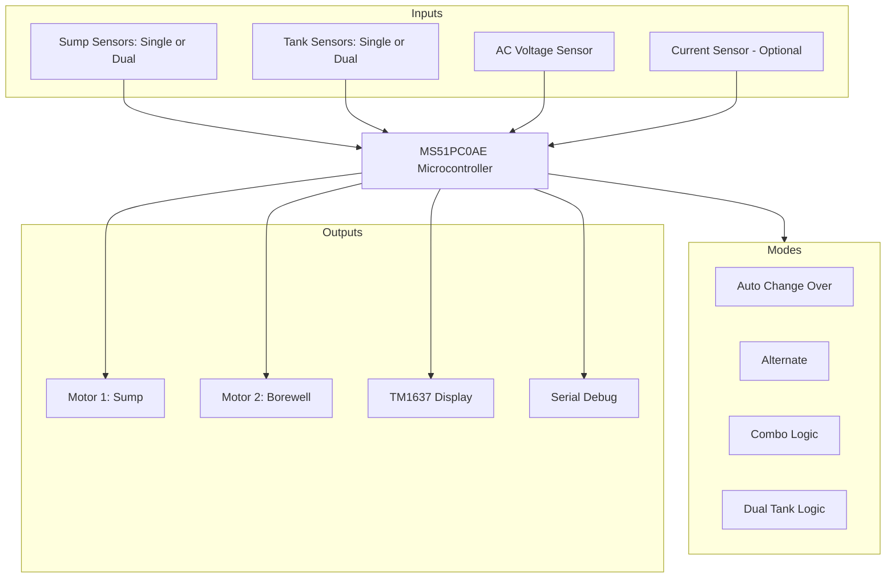

# Water Level Controller Firmware (Indicator Model V1)

This project contains the firmware for a dual-motor and dual-source Water Level Controller developed on the Nuvoton MS51 series (MS51PC0AE). It is designed to intelligently manage water transfer between a Borewell, a Sump, and an Overhead Tank.

## Core Features
- **Dual Motor Support**: Independent control of two motors (Sump Pump and Borewell Pump) via dedicated relays.
- **Advanced Operation Modes**: Six distinct modes to handle various plumbing architectures:
    - **ACO (Auto Change Over)**: Primary Sump operation with automatic fallback to Borewell if the Sump is dry.
    - **ACC (Auto Change Over with Cycles)**: Combines configurable cycle-based alternation with automatic source switching (ACO). Supports M1:M2 cycle ratio (e.g., 2:4).
    - **SAL (Sump Alternate)**: Alternates between two sources/motors with simple 1:1 logic.
    - **SUM (Sump Mode)**: Dedicated single-source Sump-to-Tank operation.
    - **BOR (Borewell Mode)**: Dedicated single-source Borewell-to-Tank operation.
    - **COM (Combo Mode)**: Intelligent 3-stage logic (Borewell -> Sump -> Tank).
- **Dual Tank Support**: Ability to monitor and manage two separate destination tanks using shared sensor inputs.
- **Dual Sump Support**: Ability to monitor two separate source sumps.
- **Independent Timing**: Separate configurable "Motor Off Time" settings for Motor 1 and Motor 2.
- **Failover Protection**: Automatic motor switching during dry run faults.
- **Voltage Safety**: Real-time AC voltage monitoring with trip points.
- **Current Sensing (Optional)**: Support for CT coil to monitor motor load (Amperes) and detect dry run/overload.

---

## Input Mapping

The system uses 8 physical sensor inputs which can be configured for either high-resolution (4 levels) or multi-reservoir (2 levels each) monitoring.

### Standard Mode (Single Sump & Single Tank)
- **Sump Sensors**: S25, S50, S75, S100 (Source level: 25%, 50%, 75%, 100%)
- **Tank Sensors**: T25, T50, T75, T100 (Destination level: 25%, 50%, 75%, 100%)

### Dual Sump Mode (`SUM` = 2)
Splits the sump inputs to monitor two reservoirs:
- **Sump 1 (SM1)**: Uses `S25` (50%) and `S50` (100%)
- **Sump 2 (SM2)**: Uses `S75` (50%) and `S100` (100%)

### Dual Tank Mode (`DTK` = ENA)
Splits the tank inputs to monitor two destination tanks:
- **Tank 1 (TN1)**: Uses `T25` (50%) and `T50` (100%)
- **Tank 2 (TN2)**: Uses `T75` (50%) and `T100` (100%)

---

## Hardware Configuration

### Output Mapping
- **Relay 0 & 1**: Motor 1 Control (Primary Sump Motor).
- **Relay 2 & 3**: Motor 2 Control (Borewell or Alternate Motor).
- **TM1637 Display**: 4-digit 7-segment display for UI feedback.
- **LED Indicators**: Status LEDs for flow, power, and faults.

---

## System Architecture

---

## User Interface

The device features a 4-digit TM1637 display and three user buttons for configuration and operation.

### Buttons
- **AUTO**: Switches the system to Automatic mode. In this mode, the controller manages the pumps based on water levels and voltage conditions.
- **MANUAL**: Switches the system to Manual mode. Allows the user to start/stop motors manually using the UP/DOWN buttons.
- **SET**: Enters the configuration menu. Press SET to cycle through parameters, and use the other buttons to adjust values.

### Display Rolling
In **Dual Tank** or **Dual Sump** modes, the display rolls every 3 seconds to show different reservoir levels:
- `SM1` / `SM2`: Sump 1 and Sump 2 levels.
- `TN1` / `TN2`: Tank 1 and Tank 2 levels.
- `BOR`: Displayed when in Borewell mode.
- `AMP`: Shows the motor current in Amperes (if CT is enabled).

---

## Software State Machine
The firmware utilizes a robust state machine to manage transitions:

1.  **MOTOR_OFF_SYSTEM_IDLE**: Monitoring levels and waiting for start conditions.
2.  **MOTOR_ON_PRIMARY_DRY_RUN_CHECK**: Initial start-up phase where water flow is expected.
3.  **MOTOR_ON_SECONDARY_DRY_CHECK**: Extended check if flow is delayed.
4.  **MOTOR_OFF_DRY_RUN_FAULT**: Emergency shutdown if no water is detected.
5.  **MOTOR_OFF_VOLTAGE_FAULT**: Shutdown due to unsafe AC line voltage.
6.  **MOTOR_OFF_OVERCURRENT_FAULT**: Shutdown due to high motor current.
7.  **MOTOR_OFF_RESET_DELAY**: Configurable cooldown period after a cycle or fault.
8.  **MOTOR_OFF_SENSOR_ERROR**: Safety shutdown if sensor wiring is inconsistent.

---

## File Structure
- `WLC_Indicator_model.c`: Main entry point and system loop.
- `WLC_Functions.c / .h`: Core logic for water level management, modes, and settings.
- `GPIO_Config.c / .h`: Hardware pin assignments and initialization.
- `ADC_inputs.c / .h`: Drivers for ADC sensing (Voltage, Buttons, Current Transformer).
- `TM1637.c / .h`: Display driver for the 7-segment LED module.
- `Timer3_Int.c / .h`: System tick timer (100ms) for timing and delays.

---

## Configuration Settings
Accessible via the onboard UI (SET button):

| Parameter | Description | Options |
| :--- | :--- | :--- |
| **POD** | Power On Delay | 0 - 999 Seconds |
| **DR1 / DR2** | Dry Run Timeouts | Primary / Secondary timeouts |
| **RST** | Dry Run Reset Time | Minutes until auto-restart |
| **TON / TOF** | Tank On/Off Levels | Start/Stop thresholds (e.g., 50/100) |
| **DTK** | Dual Tank Mode | ENA (Enable) / DIS (Disable) |
| **SUM** | Sump Type | BOR (Bore only), 1 (Single), 2 (Dual) |
| **MO1 / MF1** | Motor 1 Timing | On Time / Off Timer (Minutes) |
| **VOL / VOH** | AC Voltage Range | Min/Max trip points |
| **OFF** | Off-time Tank Level | Level to trigger off-timer reset |
| **RPL** | Relay Pulse | Duration for pulse-start starters |
| **STA** | Starter Type | OLD (Mechanical) / ELE (Electronic) |
| **DM** | Dual Motor Enable | ENA / DIS |
| **MOD** | Operational Mode | ACO, ACC, ALT, SUM, BOR, COB (0-5) |
| **CY1** | Motor 1 Cycles (ACC only) | Number of Motor 1 runs per alternation |
| **CY2** | Motor 2 Cycles (ACC only) | Number of Motor 2 runs per alternation |
| **CTE** | CT Enable | Enable current sensing |
| **AM1** | Reference Current 1 | Motor 1 rated current |
| **AM2** | Reference Current 2 | Motor 2 rated current |

---

## Build Instructions
1. Open the project using **Keil µVision**.
2. Select the **Nuvoton MS51PC0AE** target.
3. Ensure the **HIRC 24MHz** internal oscillator is selected.
4. Compile the project and flash using a **Nu-Link** debugger.

---

## Recent Improvements & Stability
The firmware has recently undergone a comprehensive stability and logic audit to ensure reliability in complex configurations.

### Reliability & Core Fixes
- **Atomic Timing**: Implemented interrupt-safe 32-bit tick reads to prevent "torn" values on the 8-bit MCU.
- **Underflow Protection**: Fixed multiple unsigned arithmetic underflow bugs in state machine timeouts to ensure reliable state transitions.
- **Boot Stability**: Corrected uninitialized timer variables at boot and replaced fragile magic-number loop escapes with robust flags.
- **AC Voltage Optimization**: 
    - Reduced fault detection latency from 4 seconds to ~1 second for better hardware protection.
    - Improved sensing accuracy by implementing 20-sample averaging over a full 10ms (100Hz) ripple cycle, combined with an IIR low-pass filter (alpha = 0.7).
    - **Voltage Recovery Hysteresis**: Implemented a 30V hysteresis for lower-limit recovery to prevent rapid "chatter" cycling. The system now requires the voltage to reach `minACVolt + 30V` before clearing a fault.
- **Display Stability**: Centralized display update logic into a single controller function to eliminate flickering during fault states.

### Logic Enhancements
- **SAL Mode Independent Rest**: 
    - Transitioned from a global system rest to independent per-motor rest tracking.
    - Fixed a critical bug where `motorOffBySensorFlag` was not resetting, which previously blocked rest timers from starting.
    - Added real-time second-by-second countdown logs for resting motors.
- **Full Dual-Tank Support**: Restored missing operational paths for Dual-Tank mode, including automatic boot-starting, ACO/BOR mode bypass, and COM mode replenishment logic.
- **Enhanced Failover**: Extended dry-run failover logic to support all dual-motor modes, ensuring the system can automatically switch pumps if the primary motor faults.
- **Settings Transparency**: Fixed bit-width artifacts in debug logs (e.g., DualMotorEnable: 256) and added explicit Motor Mode reporting.
- **New ACC Mode (Auto Change Over + Cycles)**: 
    - Combined configurable M1:M2 cycle ratio with ACO's automatic source switching.
    - User sets `CY1` and `CY2` to configure cycles (e.g., CY1=2, CY2=4 means Motor1 runs 2 times then Motor2 runs 4 times).
    - Implemented "Motor 2 Sump Bypass": Motor 2 (Borewell) now operates without checking sump sensors, while Motor 1 (Sump) maintains strict level safety.
    - Added automatic in-cycle switching: If Motor 1 runs dry, the system seamlessly transitions to Motor 2 to complete the tank fill.
- **SAL Mode Simplified**: 
    - SAL mode now uses simple 1:1 alternation without cycle configuration.
    - Per-motor independent rest timers (MF1/MF2) are supported in both SAL and ACC modes.
- **Sump Indicator Relay (Single Motor / Single Sump)**:
    - Repurposed the unused `O_RLY_2` relay in Single Motor (`dualMotorEnable == 0`) and Single Sump (`sumpType == 1`) configurations to serve as a sump low-level indicator.
    - The relay turns ON (active-low, set to `0`) when `sumpLevel` falls below 50%, and turns OFF (set to `1`) when `sumpLevel` is 50% or above.
    - Protected the repurposed `O_RLY_2` pin from being reset during calls to `Motor2_Off()`.
- **Default Settings Adjustments**:
    - Changed default `minACVolt` setting from 180V to 140V for wider voltage tolerance by default.
- **Unified CT Coil Support**:
    - Optimized hardware usage by supporting a single CT coil on ADC Channel 9 for both motors.
    - Added independent reference current settings (`AM1` and `AM2`) to allow accurate monitoring of motors with different power ratings.
    - Implemented automatic reference switching in the monitoring loop based on the active motor.

