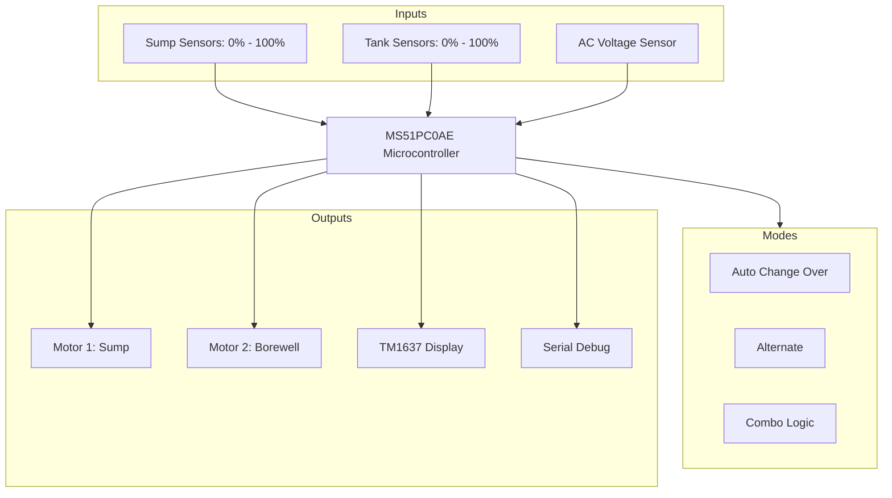

# Water Level Controller Firmware (Indicator Model V1)

This project contains the firmware for a dual-motor and dual-source Water Level Controller developed on the Nuvoton MS51 series (MS51PC0AE). It is designed to intelligently manage water transfer between a Borewell, a Sump, and an Overhead Tank.

## Core Features
- **Dual Motor Support**: Independent control of two motors (Sump Pump and Borewell Pump) via dedicated relays.
- **Advanced Operation Modes**: Five distinct modes to handle various plumbing architectures:
    - **ACO (Auto Change Over)**: Primary Sump operation with automatic fallback to Borewell if the Sump is dry.
    - **SAL (Sump Alternate)**: Alternates between two sources/motors. Supports N:1 cycle logic (e.g., Run Borewell for N cycles for every 1 Sump cycle).
    - **SUM (Sump Mode)**: Dedicated single-source Sump-to-Tank operation.
    - **BOR (Borewell Mode)**: Dedicated single-source Borewell-to-Tank operation.
    - **COM (Combo Mode)**: Intelligent 3-stage logic. Automatically fills the Sump from the Borewell when low, and fills the Tank from the Sump when available. Also includes a "Tank Full" replenishment trigger for the Sump.
- **Independent Timing**: Separate configurable "Motor Off Time" settings for Motor 1 and Motor 2 to accommodate different recovery rates for Sump and Borewell sources.
- **Failover Protection**: Automatic motor switching during dry run faults (if enabled).
- **Voltage Safety**: Real-time AC voltage monitoring with configurable Over-Voltage and Under-Voltage trip points.
- **User Interface**: 
    - **TM1637 Display**: Shows water levels, operational states, and configuration parameters.
    - **Serial Debugging**: Real-time status updates over UART, including current motor, mode, and sensor levels.

---

## Hardware Configuration

### Input Mapping
- **Sump Sensors**: S25, S50, S75, S100 (Level indicators for source reservoir).
- **Tank Sensors**: T25, T50, T75, T100 (Level indicators for destination reservoir).
- **Voltage Sensor**: AC line voltage feedback.
- **User Keys**: AUTO, MANUAL, and SET buttons for configuration and mode switching.

### Output Mapping
- **Relay 0 & 1**: Motor 1 Control (Primary Sump Motor).
- **Relay 2 & 3**: Motor 2 Control (Borewell or Alternate Motor).
- **TM1637 Display**: 4-digit 7-segment display for UI feedback.
- **LED Indicators**: Status LEDs for flow, power, and faults.

---

## System Architecture

## Software State Machine
The firmware utilizes a robust state machine to manage transitions between idle, motor start-up (Dry Run Check), running, and fault recovery.

1.  **MOTOR_OFF_SYSTEM_IDLE**: Monitoring levels and waiting for start conditions.
2.  **MOTOR_ON_PRIMARY_DRY_RUN_CHECK**: Initial start-up phase where water flow is expected.
3.  **MOTOR_ON_SECONDARY_DRY_CHECK**: Extended check if flow is delayed.
4.  **MOTOR_OFF_DRY_RUN_FAULT**: Emergency shutdown if no water is detected.
5.  **MOTOR_OFF_VOLTAGE_FAULT**: Shutdown due to unsafe AC line voltage.
6.  **MOTOR_OFF_RESET_DELAY**: Configurable cooldown period after a successful cycle or fault.

---

## Configuration Settings
Accessible via the onboard UI (SET button) or Serial console:
- **POD**: Power On Delay (Seconds).
- **DR1/DR2**: Dry Run Timeouts for primary and secondary checks.
- **RST**: Dry Run Reset Time (Minutes).
- **MOD**: Operational Mode (ACO, SAL, SUM, BOR, COM).
- **CYC**: Motor 2 Cycles in SAL mode.
- **MOT1/MOT2**: Independent Off-timers for Motor 1 and Motor 2.
